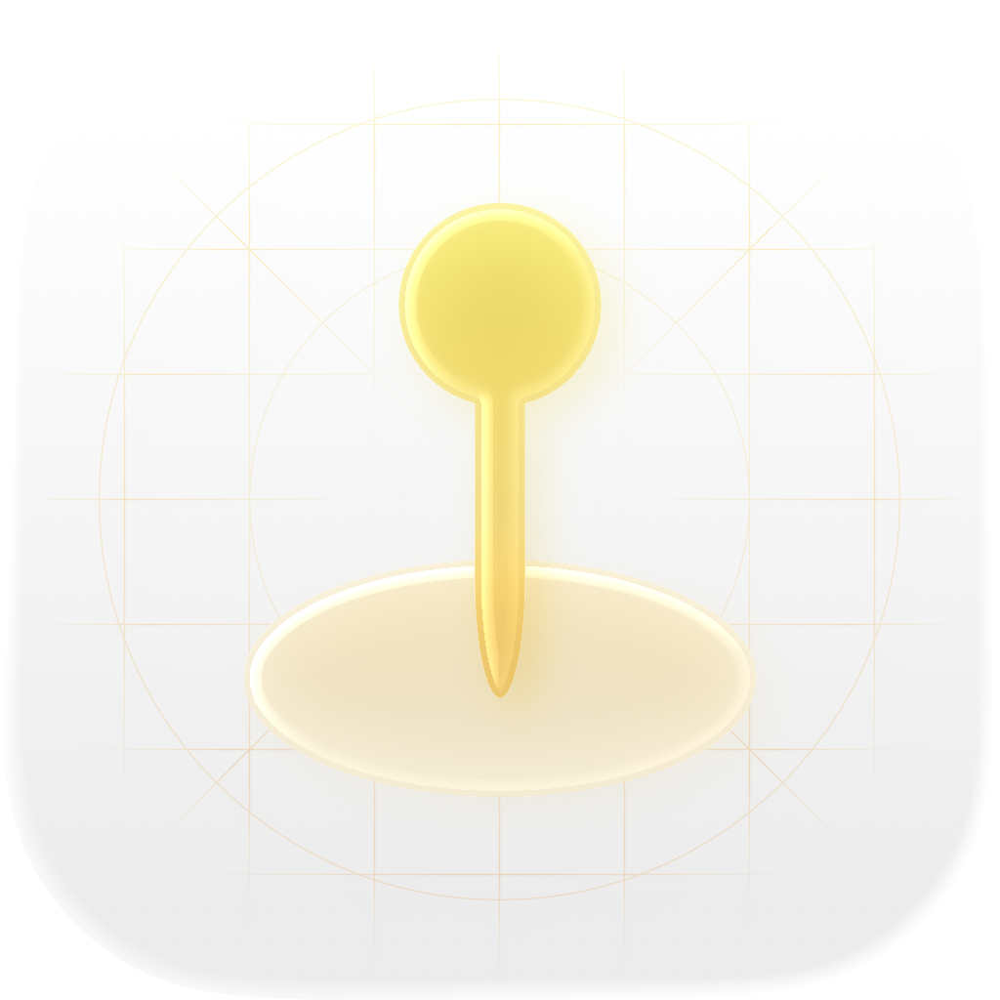

<blockquote>
  <details>
    <summary>
      <code>あ ←→ A</code>
    </summary>
    <!--Head-->
    &emsp;&ensp;<sub><b>Pinnest</b>支持以下语言。</sub>
    <br />
    <!--Body-->
    <br />
    &emsp;&ensp;<a href="/README.md">English</a>
    <br />
    &emsp;&ensp;简体中文
  </details>
</blockquote>

### <div><!--Empty Lines--><br /><br /></div>

# <p align="center"><picture><source media="(prefers-color-scheme: dark)" srcset="/Pinnest/Icon/Pinnest-iOS-Dark-1024x1024@1x.png?raw=true" /></picture><br />Pinnest</p><br />

###### <p align="center">将参考图像放在最需要的位置。</p>

### <div><!--Empty Lines--><br /><br /></div>

Pinnest是一款原生macOS菜单栏工具，可以将剪贴板中的图像轻量地悬浮在工作内容上方，用作临时参考。

复制图像，从菜单栏将其钉住，然后继续工作。每张图像彼此独立：你可以移动图像、朝指针位置缩放、旋转、调整不透明度、让点击穿透图像，或将其滞留在一个桌面。工具栏只会在需要时出现。

## 功能特性

- **钉住剪贴板的图像：**通过菜单命令或<kbd>⌘V</kbd>，从剪贴板中最新的图像创建独立悬浮参考。
- **始终位于需要的位置：**钉住的图像悬浮在普通窗口上方，并可显示在所有虚拟桌面。开启**滞留**后，图像只会留在当前桌面。
- **以指针为锚点缩放：**在图像上滚动即可朝指针位置连续缩放；使用<kbd>⌘</kbd>+滚动可在10%到100%之间调整不透明度。
- **悬浮工具栏：**关闭、复制、作为PNG文件拖出、双向旋转、输入精确缩放与不透明度、重置、移动、切换穿透或滞留模式。
- **穿透模式：**让鼠标事件穿过图像，同时保持工具栏可交互，在参考图像的同时不会阻挡下方应用。
- **虚拟桌面与全屏：**共享图像会在不同空间保持相同位置，并显示在全屏应用上方；桌面本地图像则正常参与Mission Control。
- **原生工具体验：**仅驻留菜单栏、随macOS启动、支持Sparkle签名更新，并提供英文和简体中文界面。

## 系统要求

- macOS 15.7或更高版本
- 部署目标支持的Apple芯片或Intel Mac

## 安装与运行

1. 从[GitHub Releases](https://github.com/deltaiota/Pinnest/releases/latest)页面下载最新ZIP文件。
2. 解压`Pinnest.app`并将其移动到`/Applications`。
3. 首次启动时，右键单击应用并选择**打开。**如果macOS仍然阻止启动，请在系统设置→隐私与安全性中允许Pinnest运行，然后再次打开。

## 构建

```sh
# 构建
xcodebuild build -project Pinnest.xcodeproj -scheme Pinnest \
  -destination 'platform=macOS,arch=arm64' \
  -skipPackagePluginValidation

# 测试
xcodebuild test -project Pinnest.xcodeproj -scheme Pinnest \
  -destination 'platform=macOS,arch=arm64' \
  -only-testing:PinnestTests \
  -skipPackagePluginValidation -quiet
```

你也可以直接在Xcode中打开`Pinnest.xcodeproj`。

## 架构

Pinnest使用**SwiftUI**构建菜单与内容，并使用**AppKit**实现不激活应用的悬浮面板、选择性鼠标事件穿透、原生拖拽会话、文件承诺、窗口阴影和虚拟桌面行为。

- `Pinnest/Pins/`：每张图像的状态、几何协调、悬浮面板、工具栏与提示栏管理器
- `Pinnest/Services/`：剪贴板监视、图像文件承诺以及全局与本地指针监视
- `Pinnest/Support/`：纯几何计算与全分辨率图像旋转
- `Pinnest/Views/`：SwiftUI图像、工具栏、提示栏、关于页面、数值控件和AppKit拖拽桥接
- `Configuration/`：用于Sparkle签名更新的Info.plist附加配置
- `PinnestTests/`：几何、剪贴板、真实窗口行为、工具栏、更新和本地化契约测试
- `.github/workflows/`：Apple未签名Sparkle版本打包与签名appcast生成
- `Pinnest/Icon/`：Icon Composer源文件以及默认、深色、透明和着色应用图标导出版本
- `ReleaseNotes/`：可选的版本化Markdown，会嵌入GitHub Release与Sparkle appcast
- `Docs/`：本地化文档
