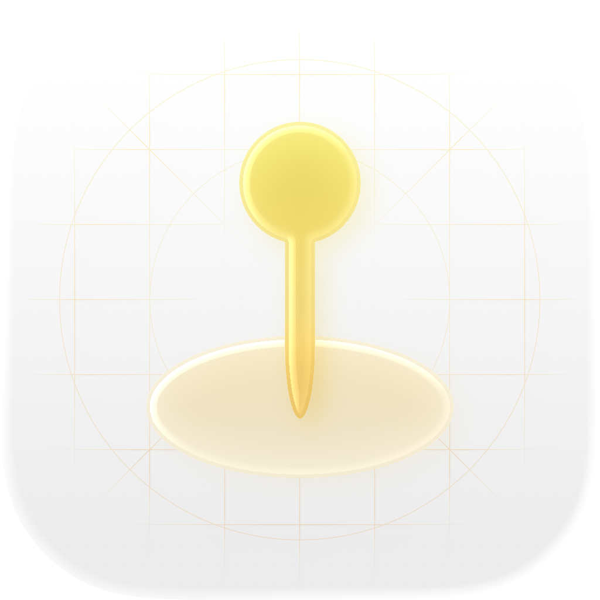

<blockquote>
  <details>
    <summary>
      <code>あ ←→ A</code>
    </summary>
    <!--Head-->
    &emsp;&ensp;<sub><b>Pinnest</b> supports the following languages.</sub>
    <br />
    <!--Body-->
    <br />
    &emsp;&ensp;English
    <br />
    &emsp;&ensp;<a href="/Docs/简体中文.md">简体中文</a>
  </details>
</blockquote>

### <div><!--Empty Lines--><br /><br /></div>

# <p align="center"><picture><source media="(prefers-color-scheme: dark)" srcset="/Pinnest/Icon/Pinnest-iOS-Dark-1024x1024@1x.png?raw=true" /></picture><br />Pinnest</p><br />

###### <p align="center">Keep a reference exactly where you need it.</p>

### <div><!--Empty Lines--><br /><br /></div>

Pinnest is a native macOS menu bar utility for placing clipboard images above your work as lightweight, temporary references.

Copy an image, pin it from the menu bar, and keep working. Each image remains independent: move it, scale toward the pointer, rotate it, adjust its opacity, let clicks pass through it, or keep it on one Desktop. The toolbar stays hidden until you need it.

## Features

- **Pin from the clipboard:** Create an independent floating reference from the newest clipboard image with one menu command or <kbd>⌘V</kbd>.
- **Always where you need it:** Pins float above ordinary windows and can appear on every virtual Desktop. Enable **Stubborn** to keep a pin on its current Desktop instead.
- **Pointer-anchored zoom:** Scroll over an image to scale continuously toward the pointer. Use <kbd>⌘</kbd>+scroll to change opacity from 10% to 100%.
- **Hover toolbar:** Close, copy, drag as a promised PNG file, rotate in either direction, enter exact scale and opacity values, reset, move, toggle piercing, or toggle Stubborn mode.
- **Piercing mode:** Make the image transparent to mouse input while its toolbar remains interactive, so you can reference it without blocking the application underneath.
- **Spaces and full screen:** Shared pins remain at the same position across Spaces and over full-screen applications. Desktop-local pins participate in Mission Control normally.
- **Native utility behavior:** Menu-bar-only lifecycle, Launch at Login, signed Sparkle update support, English, and Simplified Chinese.

## Requirements

- macOS 15.7 or later
- Apple Silicon or Intel Mac supported by the deployment target

## Install & Run

1. Download the latest ZIP from the [GitHub Releases](https://github.com/deltaiota/Pinnest/releases/latest) page.
2. Extract `Pinnest.app` and move it to `/Applications`.
3. On first launch, right-click the app and choose **Open.** If macOS still blocks it, approve Pinnest under System Settings → Privacy & Security and open it again.

> [!NOTE]
>
> Official releases are signed with a free Apple Development certificate and authenticated by Sparkle EdDSA, but they are not notarized. macOS may still require first-launch approval through Finder or Privacy & Security.

## Building

```sh
# Build
xcodebuild build -project Pinnest.xcodeproj -scheme Pinnest \
  -destination 'platform=macOS,arch=arm64' \
  -skipPackagePluginValidation

# Test
xcodebuild test -project Pinnest.xcodeproj -scheme Pinnest \
  -destination 'platform=macOS,arch=arm64' \
  -only-testing:PinnestTests \
  -skipPackagePluginValidation -quiet
```

You can also open `Pinnest.xcodeproj` directly in Xcode.

## Architecture

Pinnest is built with **SwiftUI** for its menu and content, plus **AppKit** for non-activating floating panels, selective mouse-event piercing, native drag sessions, promised files, window shadows, and Spaces behavior.

- `Pinnest/Pins/`: per-pin state, geometry coordination, floating panels, toolbar and hint presenters
- `Pinnest/Services/`: clipboard monitoring, image file promises, and global/local pointer monitoring
- `Pinnest/Support/`: pure pin geometry and full-resolution image rotation
- `Pinnest/Views/`: SwiftUI image, toolbar, hint, About, numeric controls, and AppKit drag bridges
- `Configuration/`: generated Info.plist additions for signed Sparkle updates
- `PinnestTests/`: geometry, clipboard, real-window behavior, toolbar, updater, and localization contracts
- `.github/workflows/`: Apple Development-signed release packaging and Sparkle-signed appcast generation
- `Pinnest/Icon/`: Icon Composer source and exported default, dark, clear, and tinted app-icon variants
- `ReleaseNotes/`: optional versioned Markdown embedded into GitHub Releases and the Sparkle appcast
- `Docs/`: localized documentation
